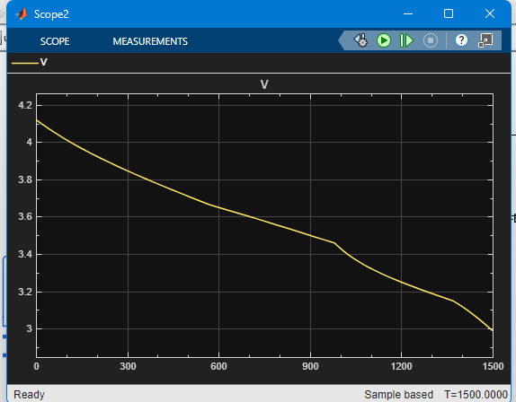

# Hybrid Cell Battery Model (Energy Cell + Power Cell)

A Simulink / Simscape model of two different lithium-ion cells in parallel sharing one load. Built as Day 7 of a 30-day self-study plan on battery management systems.

## Idea
A hybrid pack mixes cell types: a high-energy cell that stores a lot, and a high-power cell that delivers current easily. The model shows how they share a load and how that changes over time.

| | Cell A (energy) | Cell B (power) |
|---|---|---|
| Capacity | 3 Ah | 1.5 Ah |
| Terminal resistance | 40 mOhm | 10 mOhm |

Both use the same OCV-SOC table (3.0 V at 0% to 4.2 V at 100%), no dynamics (R0 only), and start fully charged. The load is a constant 10 A for 1500 s.

## Results
**Current sharing.** At the start the current divides by resistance: cell B carries 8 A (5.3C) and cell A 2 A (0.67C). As B discharges faster, its voltage falls and the load shifts to A, so the cells balance each other.

**Power.** Cell B delivers about 33 W against 8 W for cell A at the start. After about 190 s cell A delivers more, and in the last part of the run A delivers about 5 times more power than B.

**State of charge.** Cell B empties first and reaches about 0% at 1500 s, while cell A still has about 10%.

**Terminal voltage.** It starts at about 4.12 V (4.2 V minus 10 A x 8 mOhm, the parallel resistance) and falls to about 3.0 V.

## What it shows
1. The power cell takes the early peak, which protects the energy cell.
2. The cells balance through the shared voltage, without a controller.
3. Late in the discharge, the energy cell carries about 2.9C, far above its starting 0.67C, so the protection fades.
4. The power cell sets the usable capacity, because it empties first.

## How to run
Open `hybrid_cells_model.slx` in MATLAB with Simulink, Simscape, and Simscape Electrical, set stop time 1500 s, and run.

## Limitations
- R0-only cells, no RC dynamics, no temperature or aging
- Ideal current source with no protection, so it must be stopped before a cell is empty
- Two single cells, not a full pack

## Next steps
- Scale to a full hybrid pack with series strings of each cell type
- Add BMS protection limits and thermal modelling
